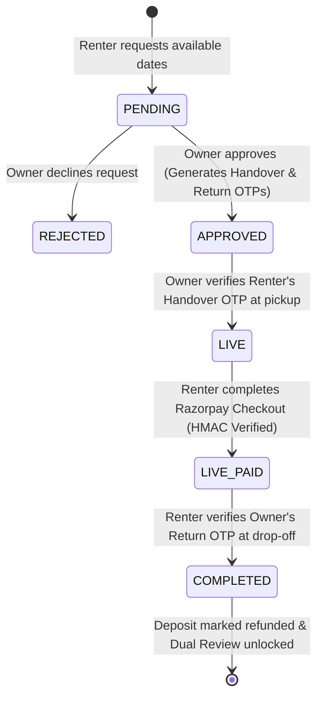

<div align="center">

# RentMate

**Peer-to-Peer Regional Rental Marketplace with Dual-OTP Handover, Real-Time WebSockets & Razorpay Escrow**

[](https://react.dev/)
[](https://tailwindcss.com/)
[](https://nodejs.org/)
[](https://www.mongodb.com/)
[](https://socket.io/)
[](https://razorpay.com/)

*Rent anything from verified peers in your region — or monetize your idle cameras, consoles, tools, and outdoor gear.*

</div>

---

## Overview

**RentMate** reimagines classifieds platforms specifically for **peer-to-peer equipment rentals**. Instead of one-off buying and selling, RentMate manages the complete physical rental lifecycle—from slot-based availability discovery and real-time pre-booking negotiation to Dual-OTP physical handovers, Razorpay checkout, live rental progress tracking, and two-way trust ratings.

---

## Key Features

### 1. Regional Discovery & Owner Studio
* **Multi-City & Category Filtering:** Browse listings across 7 Indian cities (`Chandigarh`, `Mohali`, `Panchkula`, `Delhi NCR`, `Ludhiana`, `Bangalore`, `Mumbai`) and 8 categories (`Cameras & Optics`, `Gaming & Consoles`, `Laptops & Tech`, `Camping & Outdoors`, `Power Tools & DIY`, `Sound & AV`, `Fitness & Cycles`, `Other`) with live keyword search.
* **Dedicated Owner Studio (`/my-ads`):** Upload up to 4 product photos via local `multer` disk storage, configure daily rental rates (`₹/day`) and refundable security deposits (`₹`), edit details, pause/reactivate availability, or permanently delete listings.
* **Personal Analytics Dashboard (`/dashboard`):** Live summary of total rental earnings (`₹`), security deposits held, active bookings, listed gear, trust rating, and 1-click pending action items.

### 2. Slot-Based Booking & Dynamic Pricing Engine
* **Date-Conflict Prevention:** Interactive availability calendar (`react-day-picker`) disables past dates and blocks any date range overlapping with existing `APPROVED` or `LIVE` bookings (`startDate <= existingEnd && endDate >= existingStart`).
* **Automated Multi-Day Pricing:** Server-side cost engine calculates inclusive rental days, applies an automatic **10% discount** on base rent for rentals of **7+ days**, and bundles the refundable security deposit:
  $$\text{Total Payable} = \text{Discounted Rent} + \text{Refundable Security Deposit}$$

### 3. Dual-OTP Physical Handover State Machine
Every booking enforces a strict server-side state machine with **role-scoped 4-digit OTPs**:



* **Role-Scoped Security:** Booking responses reveal `handoverOtp` *only* to the renter while `APPROVED`, and `returnOtp` *only* to the owner while `LIVE` and paid.

### 4. Real-Time WebSockets, Notifications & Order Drawers
* **Product-Connected Chat (`/chats`):** Two-pane Socket.io messaging with a clickable **Product Context Banner** (`View Product ↗`) at the top of each thread to jump back to `/item/:id`.
* **Live Notification Bell:** Real-time alerts (`new_notification` socket events) for new requests, approvals/rejections, OTP handovers, Razorpay payments, and completed returns with deep-linked drawers.
* **Order Management & Demo Time-Travel (`/incoming-orders`, `/my-rentals`, `/booking/:id`):** Dedicated owner and renter tables with slide-over drawers (inline Approve/Reject, OTP display/verification, and Razorpay Checkout), full 3-column order dashboard, itemized payment ledger, chronological activity timeline, and a **Demo Time-Travel** bar (`+24h`, `50% Progress`, `Jump to Return 100%`).

### 5. Verified Peer & Two-Way Trust Layer (`/account`)
* **Peer Verification Badge:** Profile verification badge displayed across item cards, chat headers, and order dashboards.
* **Dual Post-Rental Ratings:** Upon `COMPLETED` status, both peers can submit a 1–5 star review for **Item Condition** and **Peer Behaviour**, updating user trust scores dynamically.

---

## Tech Stack & Architecture

| Layer | Technologies |
| --- | --- |
| **Frontend** | React 18, Vite, Tailwind CSS, React Router v6, Lucide Icons, Axios, Socket.io Client, `react-day-picker`, `date-fns` |
| **Backend** | Node.js, Express.js, Socket.io, JSON Web Tokens (`jsonwebtoken`), `bcryptjs`, `multer`, Node `crypto` |
| **Database** | MongoDB with Mongoose ODM (`User`, `Item`, `Booking`, `Conversation`, `Message`, `Notification`, `Review`) |
| **Payments** | Razorpay Orders API + Standard Checkout SDK + HMAC SHA256 Signature Verification |

### Project Structure

```text
p2p-rental-marketplace/
├── backend/
│   ├── config/           # MongoDB connection setup
│   ├── controllers/      # Route handlers (auth, items, bookings, payments, chats, notifications, reviews)
│   ├── middleware/       # JWT auth guards & Multer disk upload config
│   ├── models/           # Mongoose schemas (User, Item, Booking, Conversation, Message, Notification, Review)
│   ├── routes/           # Express REST API routers
│   ├── socket/           # Socket.io JWT handshake & room event handlers
│   ├── uploads/          # Local static storage for uploaded item images
│   ├── utils/            # Booking calculation & notification helpers
│   ├── seed.js           # Demo accounts & regional catalog seeder
│   └── server.js         # Express + Socket.io HTTP server entry point
├── frontend/
│   ├── src/
│   │   ├── components/   # Navbar, NotificationBell, OrdersWorkspace, ItemCard, AuthModal, Footer
│   │   ├── context/      # AuthContext & SocketContext
│   │   ├── pages/        # HomePage, ItemDetailPage, PostAdPage, MyAdsPage, IncomingOrders, MyRentals, BookingDetail, ChatsPage, Dashboard, AccountPage
│   │   ├── services/     # Axios API client with Bearer token interceptor
│   │   └── utils/        # Rental progress & timeline helpers
│   └── index.html        # Includes Razorpay Checkout SDK
└── README.md
```

---

## Getting Started

### Prerequisites
* **Node.js** (v18+ recommended)
* **MongoDB** running locally on `mongodb://127.0.0.1:27017`
* **Razorpay Test Mode** API Keys (`RZP_KEY_ID` and `RZP_KEY_SECRET`)

### 1. Clone the Repository

```bash
git clone https://github.com/harshxt022/p2p-rental-marketplace.git
cd p2p-rental-marketplace
```

### 2. Configure Backend Environment

Create `backend/.env` with your local configuration:

```env
PORT=5000
MONGO_URI=mongodb://127.0.0.1:27017/RentKaro
JWT_SECRET=your_super_secret_jwt_key
CLIENT_URL=http://localhost:5173
RZP_KEY_ID=your_razorpay_test_key_id
RZP_KEY_SECRET=your_razorpay_test_key_secret
```

### 3. Install Dependencies & Seed Demo Data

```bash
# Terminal 1 — Backend
cd backend
npm install
node seed.js
npm start
```

```bash
# Terminal 2 — Frontend
cd frontend
npm install
npm run dev
```

Open **`http://localhost:5173`** in your browser.

---

## Demo Walkthrough Credentials

Running `node seed.js` populates regional listings and two ready-to-test verified peer accounts:

| Role | Email | Password | City |
| --- | --- | --- | --- |
| **Owner / Peer 1** | `rahul@demo.com` | `123456` | Chandigarh |
| **Renter / Peer 2** | `priya@demo.com` | `123456` | Mohali |

> **Tip for Live Demos:** Open `rahul@demo.com` in a standard browser window and `priya@demo.com` in an Incognito window to experience real-time WebSocket chat, live notification badges, dual-OTP handovers, Razorpay Test Mode checkout, and the Demo Time-Travel bar side-by-side.

---

## Core API Endpoints

| Method | Endpoint | Description |
| --- | --- | --- |
| `POST` | `/api/auth/register` & `/login` | JWT authentication & user session issuance |
| `GET` / `POST` / `DELETE` | `/api/items` | Search/filter listings, upload via `multer`, pause or permanently delete (`?permanent=true`) |
| `GET` | `/api/bookings/item/:itemId/booked-dates` | Fetch active date ranges to disable unavailable calendar slots |
| `POST` | `/api/bookings` | Validate date overlap & create a `PENDING` rental request |
| `PATCH` | `/api/bookings/:id/approve` & `/reject` | Owner approves/declines booking & generates 4-digit Handover/Return OTPs |
| `POST` | `/api/bookings/:id/verify-handover` | Owner verifies Renter's Handover OTP (`APPROVED` → `LIVE`) |
| `POST` | `/api/payments/create-order` & `/verify` | Create Razorpay order & verify HMAC SHA256 payment signature |
| `POST` | `/api/bookings/:id/fast-forward` | Demo clock offset (`+24h`, `50%`, `100%`) for live progress simulation |
| `POST` | `/api/bookings/:id/verify-return` | Renter verifies Owner's Return OTP (`LIVE` → `COMPLETED`) |
| `GET` / `POST` | `/api/chats` & `/api/notifications` | Real-time Socket.io messaging & unread notification management |
| `POST` / `GET` | `/api/reviews` | Submit dual 1–5 star post-rental reviews & fetch item reviews |
